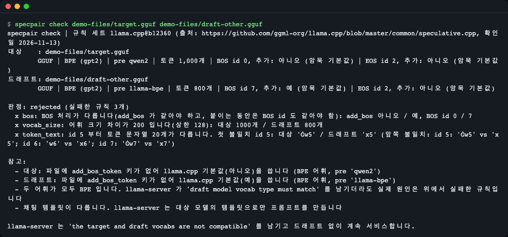
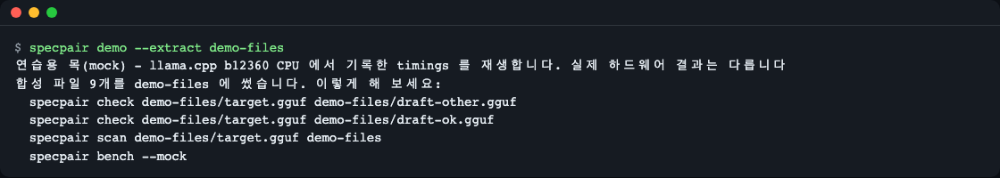
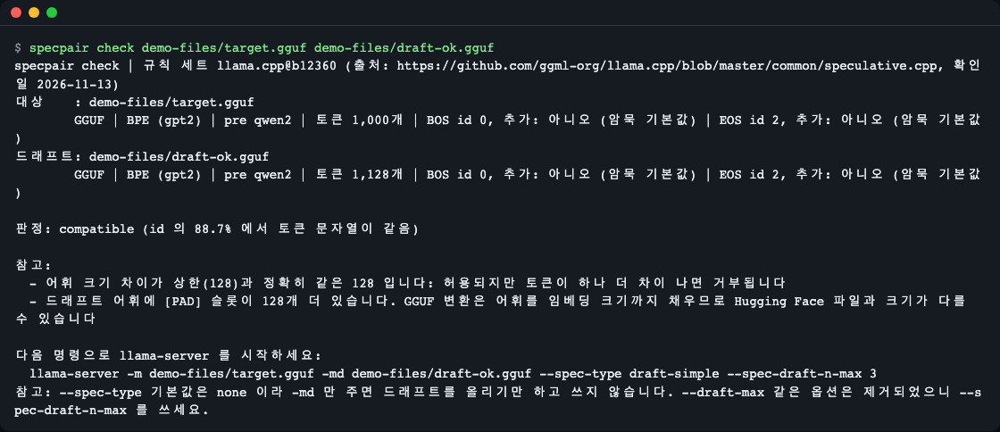
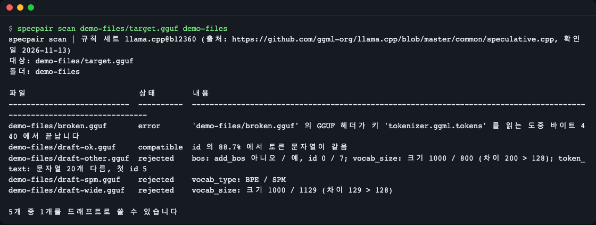
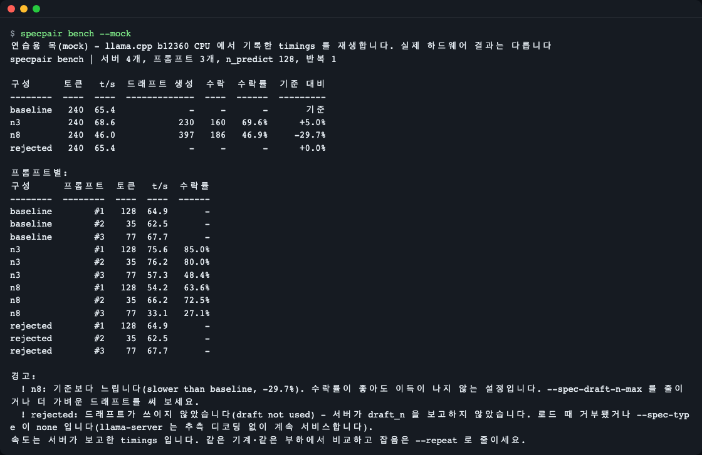
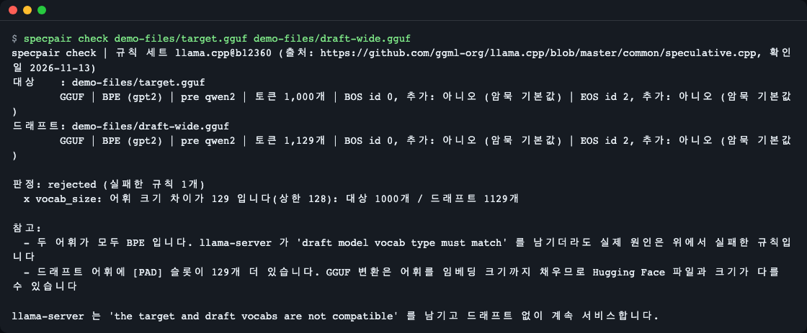
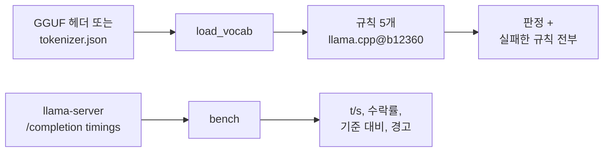

# specpair

[English](README.md) | **한국어**

specpair 는 llama.cpp 의 추측 디코딩(speculative decoding)에서 작은 드래프트 모델이 큰 대상 모델의 속도를 높여 줄 수 있는지 **로드하기 전에** 판정합니다. GGUF 헤더(또는 Hugging Face 토크나이저 파일)만 읽어 llama-server 와 같은 규칙을 적용하고, 실패한 규칙을 전부 보여 줍니다. 서버를 띄운 뒤에는 `specpair bench` 가 초당 토큰 수와 드래프트 수락률을 재서 드래프트가 실제로 도움이 됐는지 알려 줍니다. 런타임 의존성이 없고, 모델 파일 없이 써 볼 수 있는 연습 모드가 들어 있습니다.


*거부된 짝에 `specpair check` 를 실행한 화면(연습용 파일). 실패한 규칙 3개와 처음 어긋난 토큰이 한 번에 보입니다.*

## 왜 필요한가

llama-server 에 드래프트 모델을 붙여 본 사람이 흔히 놀라는 세 가지입니다(2026-11-13 확인: [`common/speculative.cpp`](https://github.com/ggml-org/llama.cpp/blob/master/common/speculative.cpp), 이 프로젝트가 llama.cpp b12360 에서 직접 돌려 본 프로브).

- 거부된 짝은 오류가 아닙니다. llama-server 는 `the target and draft vocabs are not compatible` 를 남기고 단일 모델 속도로 계속 서비스하므로 눈치채기 어렵습니다.
- `-md` 만으로는 드래프트를 쓰지 않습니다. `--spec-type` 의 기본값이 `none` 이기 때문입니다.
- 수락률이 높아도 이득이 보장되지 않습니다. 기록된 프로브에서 드래프트 토큰 46.9% 가 수락된 설정이 드래프트 없는 실행보다 29.7% 느렸습니다.

## 이런 분께

- `llama-server` 를 쓰고, 받아 둔 GGUF 폴더에서 드래프트 후보를 하나씩 로드하지 않고 고르고 싶을 때
- `llama-server` 가 `draft model vocab type must match` 를 남겼거나 GUI 의 드래프트 목록이 비어서 진짜 이유를 알고 싶을 때
- 드래프트를 붙였는데 빨라지지 않아서, 드래프트가 쓰이기는 했는지 알고 싶을 때

회의장의 통역사 둘을 떠올려 보세요. 빠른 쪽이 먼저 짐작하려면 둘이 같은 사전을 써야 합니다. `check` 는 사전(토큰 목록)을 비교하고, `bench` 는 앞서 짐작하는 방식이 정말 시간을 아끼는지 잽니다.

## 설치

```bash
# uv (Python 패키지 실행기): https://docs.astral.sh/uv/
curl -LsSf https://astral.sh/uv/install.sh | sh
# 설치 없이 실행
uvx --from git+https://github.com/LeeGyeongPil/specpair specpair --version
# 또는 명령으로 설치
uv tool install git+https://github.com/LeeGyeongPil/specpair
```

Python 3.10 이상이면 되고 다른 패키지는 필요 없습니다. 최소 리눅스 이미지에서는 위 명령에 `git` 과 `curl` 이 필요합니다. 아래 설명은 `specpair` 명령이 PATH 에 있다고 가정합니다.

## 빠르게 시작하기 (연습용 목 모드)

모델을 내려받지 않아도 됩니다. `specpair demo` 는 아주 작은 합성 GGUF 헤더와 미리 기록한 timings 로 전부 돌려서, 오프라인에서 1초쯤 걸립니다.

```bash
specpair demo --extract demo-files
```

```text
연습용 목(mock) - llama.cpp b12360 CPU 에서 기록한 timings 를 재생합니다. 실제 하드웨어 결과는 다릅니다
합성 파일 9개를 demo-files 에 썼습니다. 이렇게 해 보세요:
  specpair check demo-files/target.gguf demo-files/draft-other.gguf
  specpair check demo-files/target.gguf demo-files/draft-ok.gguf
  specpair scan demo-files/target.gguf demo-files
  specpair bench --mock
```


*연습 파일이 `demo-files/` 로 복사됩니다. 진짜 GGUF 헤더라서 `check`·`scan` 이 실제 규칙을 그대로 적용합니다.*

`--extract` 없이 `specpair demo` 만 실행하면 아래 단계를 전부 보여 주는 안내 투어가 나옵니다.

연습 모드에서 진짜인 것과 목(mock)인 것:

| 부분 | 연습 모드 |
|---|---|
| `check`, `scan` | 합성 GGUF 헤더(몇 KB, 가중치 없음)에 실제 코드가 돌아갑니다. |
| `bench --mock` | 실제 HTTP 클라이언트와 계산 코드가 로컬 재생 서버와 통신합니다. 숫자는 llama.cpp b12360 을 CPU 에서 돌려 기록한 timings(Qwen2.5-1.5B 와 0.5B, q4_0)이지 내 컴퓨터에서 잰 값이 아닙니다. `rejected` 줄은 파생값입니다. 기준선 timings 를 그대로 재사용하고 `draft_n` 을 보고하지 않게 만들어, 거부된 짝에서 llama-server 가 단독 속도로 계속 서비스했던 기록을 재현한 것입니다. |

## 사용법

| 명령 | 하는 일 |
|---|---|
| `specpair check TARGET DRAFT` | 한 쌍의 로드 전 판정. GGUF 파일 또는 토크나이저 폴더 |
| `specpair scan TARGET DIR` | 폴더(와 바로 아래 하위 폴더)의 GGUF 마다 판정 표 |
| `specpair bench --base URL --spec [LABEL=]URL` | 실행 중인 llama-server 들을 같은 프롬프트로 비교 |
| `specpair bench --mock` | 기록된 timings 재생 연습 |
| `specpair demo [--extract DIR]` | 오프라인 투어 / 연습 파일 복사 |
| `--json`, `--lang en\|ko` | 기계가 읽는 출력, 화면 언어 |

### 한 쌍 검사하기

```bash
specpair check demo-files/target.gguf demo-files/draft-other.gguf
```


*거부됨: BOS 처리, 어휘 크기, 토큰 문자열이 모두 다릅니다. llama.cpp 는 첫 실패에서 멈추지만 specpair 는 전부 보여 줍니다.*

읽는 법: `판정: rejected (실패한 규칙 3개)` 는 llama-server 가 `the target and draft vocabs are not compatible` 을 남기고 드래프트 없이 계속 서비스한다는 뜻입니다. `x` 줄마다 규칙 이름과 숫자가 나옵니다. 거부된 짝의 종료 코드는 1 입니다.

`llama.cpp@b12360` 규칙 세트의 규칙 5개:

| 규칙 | 이럴 때 실패 |
|---|---|
| `vocab_type` | 토크나이저 종류가 다름(BPE 와 SPM 등) |
| `bos` | "BOS 추가" 설정이 다르거나, BOS 를 붙이는 동안 BOS id 가 다름 |
| `eos` | EOS 에 대해 같은 규칙 |
| `vocab_size` | 어휘 크기가 128 넘게 차이 남 |
| `token_text` | id 5 부터 토큰 문자열이 하나라도 다름 |

통과하는 짝:

```bash
specpair check demo-files/target.gguf demo-files/draft-ok.gguf
```


*호환됨. 크기 차이가 상한과 같은 128 이라 토큰이 하나 더 다르면 거부되고, 출력이 이를 알려 줍니다. 쓸 llama-server 명령도 함께 나옵니다.*

`--spec-type 기본값은 none 이라 -md 만 주면 드래프트를 올리기만 하고 쓰지 않습니다` 줄을 눈여겨보세요. `--draft-max` 같은 옵션은 b12360 에서 제거됐으니 `--spec-draft-n-max` 를 씁니다.

이 상한은 실제로 자주 걸립니다. 이 프로젝트의 조사에서 Qwen2.5-7B 와 Qwen2.5-0.5B GGUF 는 토큰 수가 정확히 128 차이였습니다(152,064 와 151,936). GGUF 변환이 어휘를 패딩하기 때문에 Hugging Face 토크나이저 파일과 크기가 다를 수 있고, specpair 는 그런 경우 참고를 붙입니다. 최종 확인은 GGUF 로 하세요. 토크나이저 폴더도 어느 쪽에든 쓸 수 있습니다.

```bash
specpair check demo-files/target.gguf demo-files/hf-draft
```

```text
specpair check | 규칙 세트 llama.cpp@b12360 (출처: https://github.com/ggml-org/llama.cpp/blob/master/common/speculative.cpp, 확인일 2026-11-13)
대상    : demo-files/target.gguf
        GGUF | BPE (gpt2) | pre qwen2 | 토큰 1,000개 | BOS id 0, 추가: 아니오 (암묵 기본값) | EOS id 2, 추가: 아니오 (암묵 기본값)
드래프트: demo-files/hf-draft
        HF | BPE | 토큰 1,000개 | BOS id 0, 추가: 아니오 (암묵 기본값) | EOS id 2, 추가: 아니오 (암묵 기본값)

판정: compatible (id 의 100.0% 에서 토큰 문자열이 같음)

참고:
  - Hugging Face 토크나이저 폴더를 사용했습니다. GGUF 변환은 어휘 크기(패딩)와 add_bos 기본값을 바꿀 수 있으니 GGUF 파일로 확인하세요

토크나이저 파일 기준으로는 호환됩니다. 명령을 만들기 전에 두 모델을 GGUF 로 변환해 GGUF 파일로 다시 확인하세요.
```

분할 모델(`...-00001-of-00002.gguf`)은 첫 파일로 검사합니다. 헤더가 온전하면 부분 다운로드 파일도 괜찮습니다.

### 폴더 훑기

```bash
specpair scan demo-files/target.gguf demo-files
```


*GGUF 하나당 한 줄. 깨진 파일은 바이트 위치와 함께 `error` 줄이 되고 훑기는 계속됩니다.*

맞는 드래프트가 하나라도 있으면 종료 코드 0, 없으면 1 입니다.

### llama-server 로 실측하기

호환은 필요조건일 뿐 충분조건이 아닙니다. 기준 서버 하나와 드래프트 서버 하나 이상을 띄웁니다(아래 파일 이름은 내 GGUF 로 바꿀 자리표시자이고, 플래그는 `check` 가 알려 주는 것입니다).

```bash
llama-server -m target.gguf --port 8080
llama-server -m target.gguf -md draft.gguf --spec-type draft-simple --spec-draft-n-max 3 --port 8081
llama-server -m target.gguf -md draft.gguf --spec-type draft-simple --spec-draft-n-max 8 --port 8082
specpair bench --base http://127.0.0.1:8080 --spec n3=http://127.0.0.1:8081 --spec n8=http://127.0.0.1:8082
```

`bench` 를 시작하기 전에 서버가 모두 떠 있어야 합니다(`/health` 응답). 같은 컴퓨터에서 같은 부하로 돌리세요. `bench` 는 같은 프롬프트(내장 3개, 또는 한 줄에 하나인 파일이나 JSONL 을 `--prompts FILE` 로)를 탐욕 디코딩으로 기본 128토큰(`--n-predict`) 보내고, 워밍업 요청을 한 번 하며, `--repeat N` 으로 잡음을 줄입니다. 벽시계가 아니라 서버가 보고한 timings 를 씁니다. 실제 실행은 서버 하나당 수십 초가 걸릴 수 있고, 컴퓨터가 바쁘면 더 걸립니다.

연습 버전은 같은 코드에 기록된 timings 를 재생합니다.

```bash
specpair bench --mock
```


*연습용 목. n3 는 5.0% 빨라졌고, n8 은 드래프트 토큰의 46.9% 가 수락됐는데도 29.7% 느려졌으며, `rejected` 는 드래프트 없이 기준 속도로 돌았습니다.*

표와 경고를 읽는 법:

| 열·경고 | 뜻 |
|---|---|
| `t/s` | 서버 자체 timings 로 계산한 초당 생성 토큰 수 |
| `드래프트 생성`, `수락`, `수락률` | 드래프트가 제안한 토큰 수, 대상이 받아 준 수, 그 비율 |
| `기준 대비` | 드래프트 없는 서버 대비 속도 |
| `slower than baseline` | 2% 넘게 느림. 수락률이 높아도 이득이 보장되지 않으니 `--spec-draft-n-max` 를 줄이거나 더 가벼운 드래프트를 써 보세요 |
| `draft not used` | 서버가 `draft_n` 을 보고하지 않음: 로드 때 거부됐거나 `--spec-type` 이 `none` |
| `output differs` | 탐욕 디코딩이면 기준과 같은 글이 나와야 하므로 차이는 살펴볼 만합니다(종료 코드는 안 바뀜) |

## 설정

### 언어

| 설정 | 뜻 |
|---|---|
| `--lang en\|ko` | 화면 언어. 하위 명령 앞뒤 어디든 가능 |
| `SPECPAIR_LANG=en\|ko` | 같은 설정을 환경 변수로 |
| `LC_ALL`, `LC_MESSAGES`, `LANG` | 위 둘이 없을 때 사용. `ko` 로 시작하면 한국어, 그 밖은 영어 |

우선순위: `--lang`, `SPECPAIR_LANG`, 로케일 변수 순입니다. 도움말(`--help`)·표·경고·실행 중 오류는 번역됩니다. argparse 의 사용법 오류 메시지만 영어로 남습니다. 예: `the following arguments are required: draft`, `invalid choice: ...` (한국어 모드에서도 `오류:` 접두사와 사용법 줄은 한국어입니다).

```bash
specpair check demo-files/target.gguf demo-files/draft-wide.gguf
```


*규칙 하나가 실패합니다. 어휘 크기 차이가 129 로 상한 128 보다 1 큽니다. 이 화면은 한국어(`SPECPAIR_LANG=ko`)입니다.*

이 문서의 스크린샷은 `SPECPAIR_LANG=ko` 로 찍었고, 영어 README 의 스크린샷은 `SPECPAIR_LANG=en` 입니다. 같은 짝의 영어 화면은 이렇게 나옵니다.

```bash
specpair --lang en check demo-files/target.gguf demo-files/draft-wide.gguf
```

```text
specpair check | rule set llama.cpp@b12360 (source: https://github.com/ggml-org/llama.cpp/blob/master/common/speculative.cpp, checked 2026-11-13)
target: demo-files/target.gguf
        GGUF | BPE (gpt2) | pre qwen2 | 1,000 tokens | BOS id 0, add: no (implicit default) | EOS id 2, add: no (implicit default)
draft : demo-files/draft-wide.gguf
        GGUF | BPE (gpt2) | pre qwen2 | 1,129 tokens | BOS id 0, add: no (implicit default) | EOS id 2, add: no (implicit default)

verdict: rejected (1 rule failed)
  x vocab_size: vocabulary sizes differ by 129 (limit 128): target 1000 vs draft 1129 tokens

notes:
  - both vocabularies are BPE; llama-server may still log 'draft model vocab type must match' - the real reason is one of the failed rules above
  - the draft vocabulary has 129 extra [PAD] slots; GGUF conversion pads the vocabulary to the embedding size, so sizes can differ from the Hugging Face files

llama-server would log 'the target and draft vocabs are not compatible' and keep serving without the draft.
```

키도 필요 없고, `bench` 가 내 서버와 통신하는 것 외에 네트워크 호출도 없습니다.

### JSON 출력과 종료 코드

`check`, `scan`, `bench` 는 `--json` 을 받습니다. 키는 어느 언어에서나 영어이고 `message` 문자열만 선택한 언어를 따릅니다.

```bash
specpair check --json demo-files/target.gguf demo-files/draft-wide.gguf
```

```text
{
  "schema_version": 1,
  "runtime": "llama.cpp@b12360",
  "verdict": "rejected",
  "failures": [
    {
      "rule": "vocab_size",
      "message": "어휘 크기 차이가 129 입니다(상한 128): 대상 1000개 / 드래프트 1129개",
  ...
```

(출력은 `evidence`, `notes`, `target`, `draft`, `same_id_ratio`, `recommended_command` 로 이어집니다. 거부된 짝에서는 `recommended_command` 가 `null` 입니다.)

종료 코드: 0 정상, 1 판정 실패(거부된 짝, `scan` 에 쓸 만한 드래프트 없음, `slower than baseline`·`draft not used` 같은 `bench` 경고), 2 입력·연결 오류(정해진 메시지, 트레이스백 없음. 예: 빈 파일은 `'x.gguf' 이(가) 비어 있습니다(0바이트). 다시 내려받거나 올바른 파일을 지정하세요.`).

### Python API

먼저 프로젝트 환경에 설치합니다(위의 `uvx`·`uv tool install` 은 격리된 도구 환경에만 설치합니다).

```bash
uv pip install git+https://github.com/LeeGyeongPil/specpair
```

```python
from specpair import check_pair, load_vocab

target = load_vocab("demo-files/target.gguf")
draft = load_vocab("demo-files/draft-wide.gguf")
result = check_pair(target, draft)
print(result.verdict, [f.rule for f in result.failures])
```

```text
rejected ['vocab_size']
```

`load_vocab` 은 GGUF 파일이나 토크나이저 폴더를 받습니다. 오류는 `SpecpairError` 에서 갈라집니다(`InputNotFoundError`, `NotGGUFError`, `TruncatedHeaderError` 등).

## 동작 원리



- GGUF 읽기는 파일 앞쪽의 키-값 영역만 읽고 큰 배열은 건너뛰므로, 4GB 파일도 몇 MB 만 읽고 잘린 다운로드도 쓸 수 있습니다.
- 규칙은 데이터 파일(`src/specpair/rules/llama.cpp-b12360.json`)에 출처와 확인일과 함께 들어 있고, 모든 출력은 규칙 세트 이름으로 시작합니다.
- `bench` 는 각 서버 응답의 `predicted_n`, `predicted_ms`, `draft_n`, `draft_n_accepted` 를 가져와서 로그를 파싱할 일이 없습니다.

## 규칙 세트와 버전

규칙은 llama.cpp 빌드 b12360(`common/speculative.cpp`, 2026-11-13 확인: https://github.com/ggml-org/llama.cpp/blob/master/common/speculative.cpp)을 따릅니다. 옵션과 검사는 빌드마다 바뀌므로 출력 머리에 항상 규칙 세트 이름이 나오고, `--runtime` 은 있는 규칙 세트만 받습니다. 범위 밖: vLLM, SGLang, MLX, 전용 드래프트 헤드(EAGLE 계열·MTP), 어휘가 다른 드래프트.

## 언제 쓰나

- 잘 맞는 경우: llama-server 로 GGUF 모델을 서빙하며, 내려받거나 로드하기 전에 드래프트 짝이 받아들여지는지, 그 뒤에는 정말 빨라졌는지 알고 싶을 때
- 다른 도구: LM Studio 는 앱 안에서 드래프트 목록을 걸러 줍니다([LM Studio](https://lmstudio.ai/)). llama.cpp 가 아닌 엔진은 그 엔진의 공식 문서를 보세요(예: [vLLM](https://docs.vllm.ai/)).

## 자주 겪는 문제

| 증상 | 원인 | 해결 |
|---|---|---|
| 서버는 도는데 빨라지지 않음 | `--spec-type` 기본값이 `none` 이라 `-md` 만으로는 드래프트를 쓰지 않음 | `--spec-type draft-simple --spec-draft-n-max 3` 추가 |
| `--draft-max` 에서 `the argument has been removed` | b12360 에서 옛 옵션 이름이 제거됨 | `--spec-draft-n-max` 사용. `check` 가 현재 명령을 알려 줌 |
| 둘 다 BPE 인데 `draft model vocab type must match` 로그가 나옴 | 문구가 오해를 부름. 진짜 이유는 다른 규칙 | `specpair check` 로 실패한 규칙을 확인 |
| `bench`: `draft not used` | 로드 때 거부됐거나 `--spec-type none` | 짝을 검사하고, 그다음 플래그 확인 |
| `bench`: `slower than baseline` | 한 번에 제안하는 토큰이 너무 많거나 드래프트가 비쌈 | `--spec-draft-n-max` 를 줄이거나 더 가벼운 드래프트 |
| `이(가) 비어 있습니다(0바이트)` 또는 `ends inside the fixed GGUF header`(종료 코드 2) | 내려받은 파일이 비었거나 헤더가 끝나기 전에 잘림 | 다시 내려받기 |
| `error ... ends in the middle of key`(오류 줄) | GGUF 파일이 헤더 중간에서 잘림 | 다시 내려받기 |
| `cannot reach llama-server`(종료 코드 2) | 서버가 아직 안 떴거나 주소가 틀림 | 서버를 띄우고 `/health` 응답을 기다리기 |
| Hugging Face 로는 호환인데 GGUF 로는 거부 | 변환이 어휘를 패딩함 | GGUF 검사 결과를 따르기 |

## 개발·기여

```bash
uv run pytest -q
```

테스트는 합성 파일만 쓰고 모델을 내려받지 않습니다. `uv run python tools/make_fixtures.py [OUT_DIR]` 가 번들 연습 파일을 바이트 단위로 다시 만듭니다. 버그·제안은 이슈로 남겨 주세요. 변경 기록은 [CHANGELOG.md](CHANGELOG.md).

## 라이선스

MIT. 연습 파일은 합성 데이터이고, 재생되는 timings 는 이 프로젝트가 llama.cpp b12360(MIT)에서 Qwen2.5-1.5B-Instruct 와 Qwen2.5-0.5B-Instruct(Apache-2.0)로 직접 잰 값입니다. 모델 가중치는 들어 있지 않습니다.
