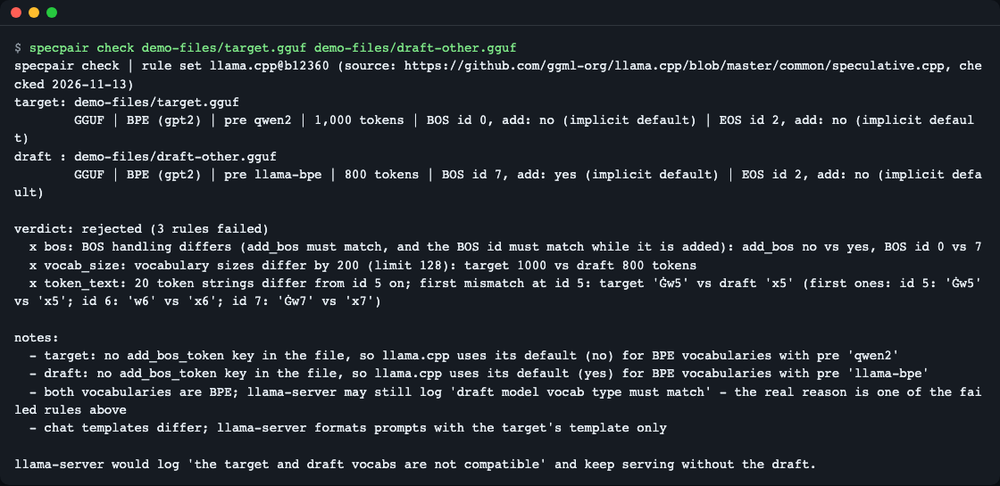
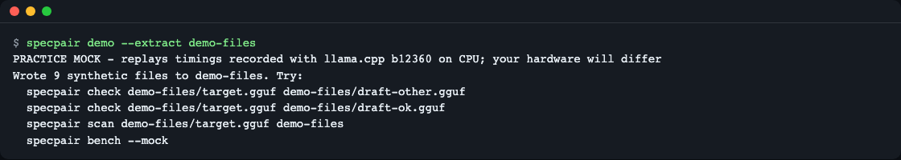
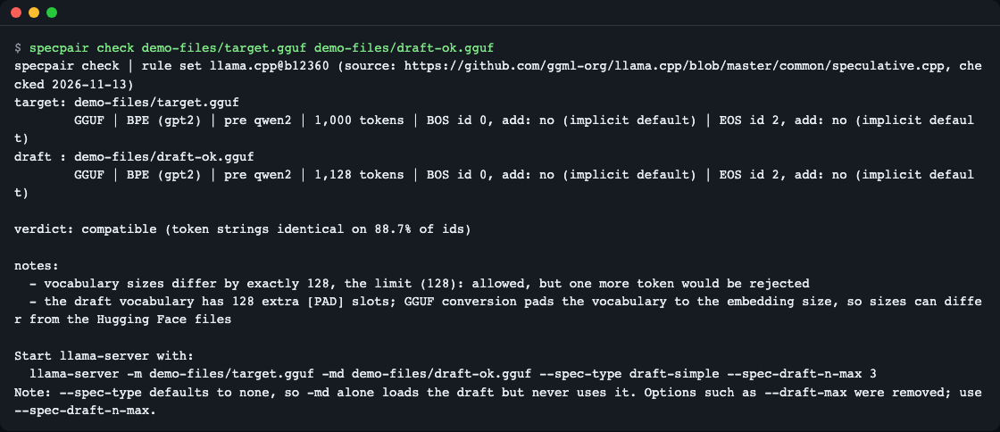
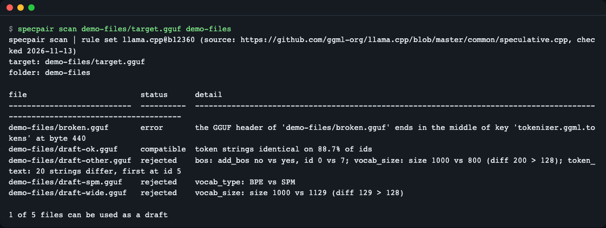
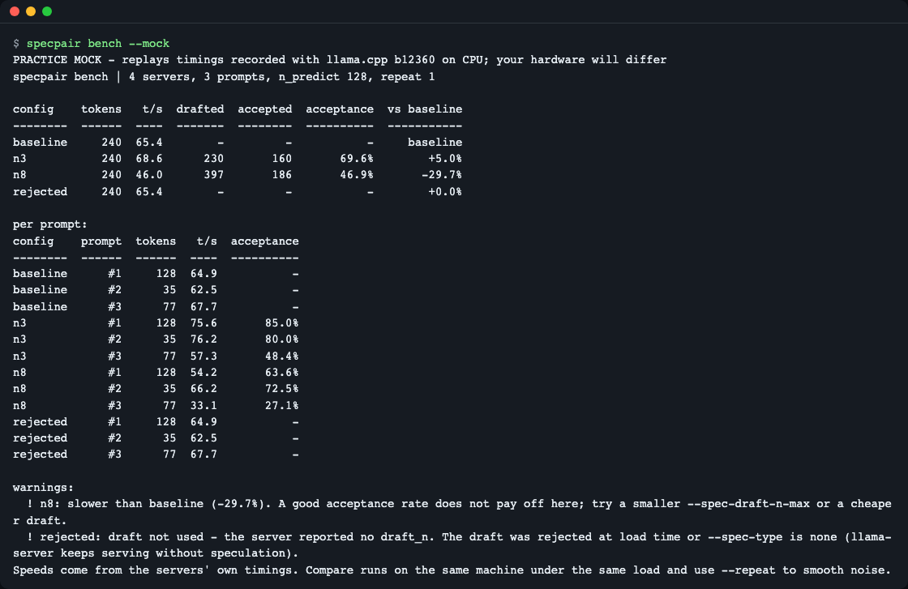
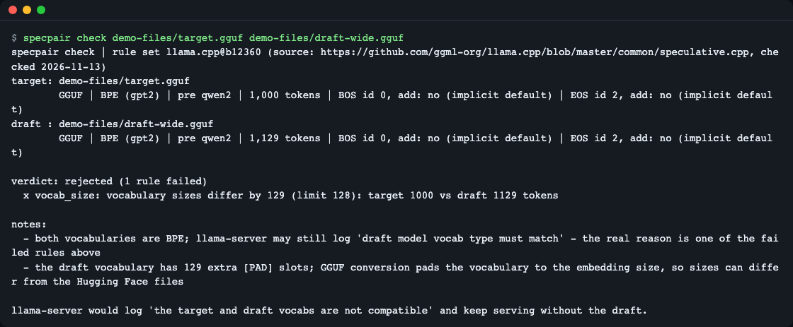
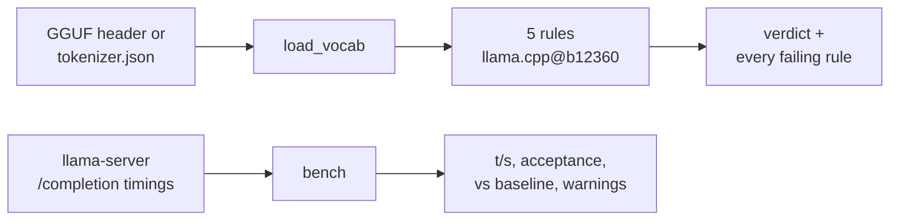

# specpair

**English** | [한국어](README.ko.md)

specpair checks, before you load anything, whether a small draft model can speed up a big target model with speculative decoding in llama.cpp. It reads only the GGUF headers (or Hugging Face tokenizer files), applies the same rules llama-server applies, and lists every rule that fails. After you start the servers, `specpair bench` measures tokens per second and the draft acceptance rate, so you can see whether the draft really helped. It has no runtime dependencies and needs no model files to try (a practice mode ships with it).


*`specpair check` on a rejected pair: all three failing rules are shown at once, with the first mismatching token (practice files).*

## Why

Three things surprise people who add a draft model to llama-server (checked 2026-11-13 against [`common/speculative.cpp`](https://github.com/ggml-org/llama.cpp/blob/master/common/speculative.cpp) and the project's own probe on llama.cpp b12360):

- A rejected pair is not an error. llama-server logs `the target and draft vocabs are not compatible` and keeps serving at single-model speed, so you may not notice.
- `-md` alone does not use the draft: `--spec-type` defaults to `none`.
- A high acceptance rate does not guarantee a gain. In the recorded probe, a draft setting with 46.9% accepted draft tokens was 29.7% slower than no draft.

## Who it is for

- You run `llama-server` and want to pick a draft GGUF from a folder of downloads without loading each one.
- `llama-server` printed `draft model vocab type must match`, or your GUI shows an empty draft list, and you want the real reason.
- You added a draft model and the server did not get faster, and you want to know whether the draft was even used.

Think of two interpreters at a meeting: the fast one can only guess ahead if both use the same dictionary. The check compares the dictionaries (token lists); the benchmark measures whether guessing ahead actually saves time.

## Install

```bash
# uv (Python package runner): https://docs.astral.sh/uv/
curl -LsSf https://astral.sh/uv/install.sh | sh
# run without installing
uvx --from git+https://github.com/LeeGyeongPil/specpair specpair --version
# or install the command
uv tool install git+https://github.com/LeeGyeongPil/specpair
```

Python 3.10 or newer; no other packages. On a minimal Linux image you also need `git` and `curl` for the commands above. The rest of this page assumes the `specpair` command is on your PATH.

## Quick start (practice mock)

No model download needed. `specpair demo` runs everything on tiny synthetic GGUF headers and on timings recorded earlier, so it works offline in about a second.

```bash
specpair demo --extract demo-files
```

```text
PRACTICE MOCK - replays timings recorded with llama.cpp b12360 on CPU; your hardware will differ
Wrote 9 synthetic files to demo-files. Try:
  specpair check demo-files/target.gguf demo-files/draft-other.gguf
  specpair check demo-files/target.gguf demo-files/draft-ok.gguf
  specpair scan demo-files/target.gguf demo-files
  specpair bench --mock
```


*The practice files are copied to `demo-files/`. The files are real GGUF headers, so `check` and `scan` run the real rules on them.*

Plain `specpair demo` (without `--extract`) prints a guided tour of all the steps below.

What is real and what is mock in practice mode:

| Part | Practice mode |
|---|---|
| `check`, `scan` | Real code on synthetic GGUF headers (a few KB, no weights). |
| `bench --mock` | The real HTTP client and math, talking to a local replay server. The numbers are timings recorded from llama.cpp b12360 on a CPU (Qwen2.5-1.5B and 0.5B, q4_0), not measured on your machine. The `rejected` line is derived: it reuses the baseline timings and reports no `draft_n`, which reproduces what the recording showed for a rejected pair (llama-server kept serving at the single-model speed). |

## Usage

| Command | What it does |
|---|---|
| `specpair check TARGET DRAFT` | Pre-load verdict for one pair; GGUF files or tokenizer folders |
| `specpair scan TARGET DIR` | Verdict table for every GGUF in a folder (and its direct sub-folders) |
| `specpair bench --base URL --spec [LABEL=]URL` | Compare running llama-server instances on the same prompts |
| `specpair bench --mock` | Practice replay of recorded timings |
| `specpair demo [--extract DIR]` | Offline tour / copy practice files |
| `--json`, `--lang en\|ko` | Machine-readable output, screen language |

### Check a pair

```bash
specpair check demo-files/target.gguf demo-files/draft-other.gguf
```


*Rejected: the BOS handling, the vocabulary size and the token strings all differ. llama.cpp stops at the first failure; specpair shows all of them.*

Read it like this: `verdict: rejected (3 rules failed)` means llama-server would log `the target and draft vocabs are not compatible` and keep serving without the draft. Each `x` line names the rule and the numbers. The exit code is 1 for a rejected pair.

The five rules of the `llama.cpp@b12360` rule set:

| Rule | Fails when |
|---|---|
| `vocab_type` | The tokenizer kinds differ (BPE vs SPM and so on). |
| `bos` | The "add BOS" flags differ, or, while BOS is added, the BOS ids differ. |
| `eos` | Same, for EOS. |
| `vocab_size` | The vocabulary sizes differ by more than 128. |
| `token_text` | Any token string differs from id 5 on. |

A pair that passes:

```bash
specpair check demo-files/target.gguf demo-files/draft-ok.gguf
```


*Compatible. The size difference is exactly 128, the limit, so one more token would be rejected, and the output says so. It also prints the llama-server command to use.*

Note the line `--spec-type defaults to none, so -md alone loads the draft but never uses it`. Options such as `--draft-max` were removed in b12360; use `--spec-draft-n-max`.

The limit is easy to hit in real life: in the project's own probe, Qwen2.5-7B and Qwen2.5-0.5B GGUF files differ by exactly 128 tokens (152,064 vs 151,936). Hugging Face tokenizer files can show different sizes than GGUF files because conversion pads the vocabulary; specpair adds a note when it sees that, so confirm with the GGUF files. A tokenizer folder works as either side:

```bash
specpair check demo-files/target.gguf demo-files/hf-draft
```

```text
specpair check | rule set llama.cpp@b12360 (source: https://github.com/ggml-org/llama.cpp/blob/master/common/speculative.cpp, checked 2026-11-13)
target: demo-files/target.gguf
        GGUF | BPE (gpt2) | pre qwen2 | 1,000 tokens | BOS id 0, add: no (implicit default) | EOS id 2, add: no (implicit default)
draft : demo-files/hf-draft
        HF | BPE | 1,000 tokens | BOS id 0, add: no (implicit default) | EOS id 2, add: no (implicit default)

verdict: compatible (token strings identical on 100.0% of ids)

notes:
  - a Hugging Face tokenizer folder was used; GGUF conversion can change the vocabulary size (padding) and the add_bos default, so confirm with the GGUF files

Compatible by tokenizer files. Convert both models to GGUF and check the GGUF files before building a command.
```

A split model (`...-00001-of-00002.gguf`) works with its first file; partial downloads are fine as long as the header is complete.

### Scan a folder

```bash
specpair scan demo-files/target.gguf demo-files
```


*One row per GGUF. The broken file becomes an `error` row with the byte position, and the scan continues.*

The exit code is 0 when at least one draft fits, 1 when none does.

### Measure with llama-server

A compatible pair is necessary, not sufficient. Start one baseline server and one or more draft servers (file names below are placeholders for your own GGUF files; the flags are the ones `check` prints):

```bash
llama-server -m target.gguf --port 8080
llama-server -m target.gguf -md draft.gguf --spec-type draft-simple --spec-draft-n-max 3 --port 8081
llama-server -m target.gguf -md draft.gguf --spec-type draft-simple --spec-draft-n-max 8 --port 8082
specpair bench --base http://127.0.0.1:8080 --spec n3=http://127.0.0.1:8081 --spec n8=http://127.0.0.1:8082
```

Each server must be up (`/health` answers) before `bench` starts. Run them on the same machine under the same load. `bench` sends the same prompts (3 built-in ones, or `--prompts FILE` with one prompt per line or JSONL), greedy decoding, 128 tokens by default (`--n-predict`), one warm-up request, and `--repeat N` smooths noise. It uses the timings the servers report, not wall-clock time. Real runs can take tens of seconds per server, more when the machine is busy.

The practice version replays recorded timings through the same code:

```bash
specpair bench --mock
```


*Practice mock. n3 is +5.0% faster, n8 is 29.7% slower even though 46.9% of its draft tokens were accepted, and `rejected` ran at baseline speed with no draft.*

How to read the table and the warnings:

| Column or warning | Meaning |
|---|---|
| `t/s` | Generated tokens per second, from the servers' own timings |
| `drafted`, `accepted`, `acceptance` | Draft tokens proposed, accepted by the target, and their ratio |
| `vs baseline` | Speed relative to the server without a draft |
| `slower than baseline` | The setting is more than 2% slower; a high acceptance rate does not guarantee a gain, try a smaller `--spec-draft-n-max` or a cheaper draft |
| `draft not used` | The server reported no `draft_n`: the draft was rejected at load time, or `--spec-type` is `none` |
| `output differs` | With greedy decoding the text should match the baseline; a difference is worth a look (does not change the exit code) |

## Settings

### Language

| Setting | Meaning |
|---|---|
| `--lang en\|ko` | Screen language. Before or after the sub-command. |
| `SPECPAIR_LANG=en\|ko` | Same, via environment. |
| `LC_ALL`, `LC_MESSAGES`, `LANG` | Used when nothing above is set: a value starting with `ko` selects Korean, anything else English. |

Order: `--lang`, then `SPECPAIR_LANG`, then the locale variables. Help (`--help`), tables, warnings and runtime errors are translated. Only argparse's usage-error messages stay English, for example `the following arguments are required: draft` and `invalid choice: ...`; in Korean mode the `오류:` prefix and the usage line are still Korean.

```bash
specpair check demo-files/target.gguf demo-files/draft-wide.gguf
```


*One rule fails: the vocabulary sizes differ by 129, one more than the limit. The screen language here is English (`SPECPAIR_LANG=en`).*

The same pair in Korean:

```bash
specpair --lang ko check demo-files/target.gguf demo-files/draft-wide.gguf
```

```text
specpair check | 규칙 세트 llama.cpp@b12360 (출처: https://github.com/ggml-org/llama.cpp/blob/master/common/speculative.cpp, 확인일 2026-11-13)
대상    : demo-files/target.gguf
        GGUF | BPE (gpt2) | pre qwen2 | 토큰 1,000개 | BOS id 0, 추가: 아니오 (암묵 기본값) | EOS id 2, 추가: 아니오 (암묵 기본값)
드래프트: demo-files/draft-wide.gguf
        GGUF | BPE (gpt2) | pre qwen2 | 토큰 1,129개 | BOS id 0, 추가: 아니오 (암묵 기본값) | EOS id 2, 추가: 아니오 (암묵 기본값)

판정: rejected (실패한 규칙 1개)
  x vocab_size: 어휘 크기 차이가 129 입니다(상한 128): 대상 1000개 / 드래프트 1129개

참고:
  - 두 어휘가 모두 BPE 입니다. llama-server 가 'draft model vocab type must match' 를 남기더라도 실제 원인은 위에서 실패한 규칙입니다
  - 드래프트 어휘에 [PAD] 슬롯이 129개 더 있습니다. GGUF 변환은 어휘를 임베딩 크기까지 채우므로 Hugging Face 파일과 크기가 다를 수 있습니다

llama-server 는 'the target and draft vocabs are not compatible' 를 남기고 드래프트 없이 계속 서비스합니다.
```

The screenshots in this README were taken with `SPECPAIR_LANG=en`; the Korean README shows the same commands with `SPECPAIR_LANG=ko`. There are no keys and no network calls apart from `bench` talking to your own servers.

### JSON output and exit codes

`check`, `scan` and `bench` accept `--json`. Keys are English in every language; only `message` strings follow the language.

```bash
specpair check --json demo-files/target.gguf demo-files/draft-wide.gguf
```

```text
{
  "schema_version": 1,
  "runtime": "llama.cpp@b12360",
  "verdict": "rejected",
  "failures": [
    {
      "rule": "vocab_size",
      "message": "vocabulary sizes differ by 129 (limit 128): target 1000 vs draft 1129 tokens",
      "evidence": {
        "target": 1000,
        "draft": 1129,
        "diff": 129,
        "max": 128
      }
    }
  ],
  ...
```

(The output continues with `notes`, `target`, `draft`, `same_id_ratio` and `recommended_command`, which is `null` for a rejected pair.)

Exit codes: 0 fine, 1 a verdict failure (rejected pair, no usable draft in `scan`, or a `bench` warning such as `slower than baseline` or `draft not used`), 2 input or connection errors with a defined message and no traceback (for example an empty file: `'x.gguf' is empty (0 bytes). Download it again or pass the right file.`).

### Python API

Install it into your project environment first (the `uvx` and `uv tool install` commands above keep it in an isolated tool environment):

```bash
uv pip install git+https://github.com/LeeGyeongPil/specpair
```

```python
from specpair import check_pair, load_vocab

target = load_vocab("demo-files/target.gguf")
draft = load_vocab("demo-files/draft-wide.gguf")
result = check_pair(target, draft)
print(result.verdict, [f.rule for f in result.failures])
```

```text
rejected ['vocab_size']
```

`load_vocab` accepts a GGUF file or a tokenizer folder. Errors derive from `SpecpairError` (for example `InputNotFoundError`, `NotGGUFError`, `TruncatedHeaderError`).

## How it works



- The GGUF reader reads only the key-value area at the start of the file and skips big arrays, so a 4 GB file costs a few megabytes of reading and a truncated download is still usable.
- The rules live in a data file (`src/specpair/rules/llama.cpp-b12360.json`) with the source and the date they were checked; every output starts with the rule set name.
- `bench` takes `predicted_n`, `predicted_ms`, `draft_n` and `draft_n_accepted` from each server's response, so there is nothing to parse in logs.

## Rule set and versions

The rules follow llama.cpp build b12360 (`common/speculative.cpp`, checked 2026-11-13: https://github.com/ggml-org/llama.cpp/blob/master/common/speculative.cpp). Options and checks change between builds; the output header always names the rule set, and `--runtime` only accepts rule sets that exist. Not covered: vLLM, SGLang, MLX, dedicated draft heads (EAGLE-style, MTP), and drafts with a different vocabulary.

## When to use it

- Good fit: you serve GGUF models with llama-server and want to know, before downloading or loading, whether a draft pair is accepted, and afterwards whether it is faster.
- Other tools: LM Studio filters its draft list inside the app ([LM Studio](https://lmstudio.ai/)); for engines other than llama.cpp use that engine's own documentation, for example [vLLM](https://docs.vllm.ai/).

## Troubleshooting

| Symptom | Cause | Fix |
|---|---|---|
| Server runs but is not faster | `--spec-type` defaults to `none`, so `-md` alone does not use the draft | Add `--spec-type draft-simple --spec-draft-n-max 3` |
| `the argument has been removed` for `--draft-max` | The old option names were removed in b12360 | Use `--spec-draft-n-max`; `check` prints the current command |
| Log says `draft model vocab type must match`, but both are BPE | The message is misleading; the real reason is another rule | Run `specpair check` and read the failing rules |
| `bench`: `draft not used` | Draft rejected at load, or `--spec-type none` | Check the pair, then the flags |
| `bench`: `slower than baseline` | Too many draft tokens per step, or a draft that is too costly | Try a smaller `--spec-draft-n-max` or a cheaper draft |
| `is empty (0 bytes)` or `ends inside the fixed GGUF header` (exit 2) | The download is empty or cut before the header ends | Download it again |
| `error ... ends in the middle of key` | The GGUF file is cut inside the header | Download it again |
| `cannot reach llama-server` (exit 2) | The server is not running yet or the URL is wrong | Start it and wait for `/health` |
| The Hugging Face check says compatible, GGUF files say rejected | Conversion pads the vocabulary | Trust the GGUF check |

## Development

```bash
uv run pytest -q
```

The tests use synthetic files only; no model is downloaded. `uv run python tools/make_fixtures.py [OUT_DIR]` regenerates the bundled practice files byte for byte. Report bugs and ideas as issues. Changes are listed in [CHANGELOG.md](CHANGELOG.md).

## License

MIT. The practice files are synthetic, and the replayed timings are the project's own measurements with Qwen2.5-1.5B-Instruct and Qwen2.5-0.5B-Instruct (Apache-2.0) on llama.cpp b12360 (MIT); no model weights are included.
